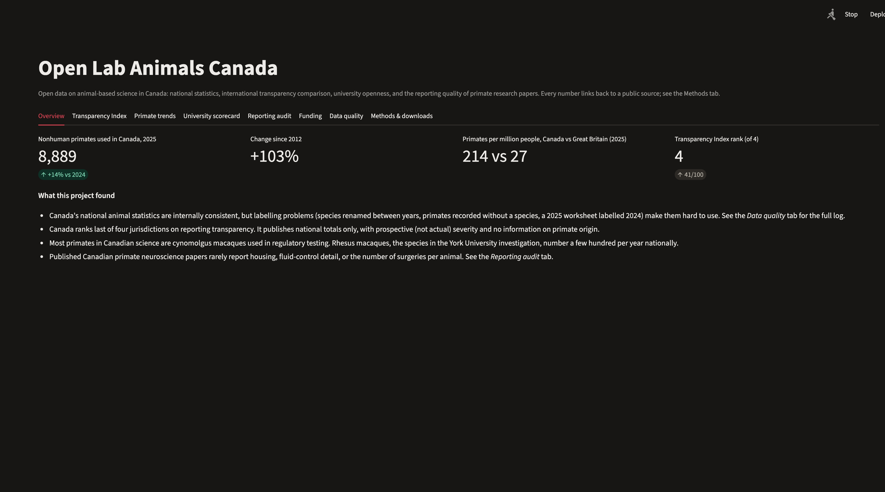
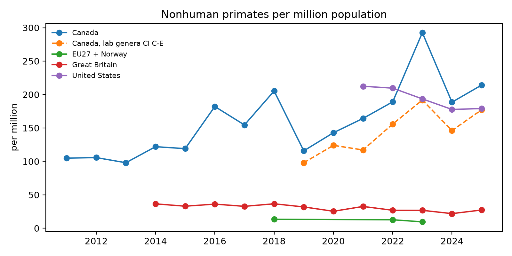
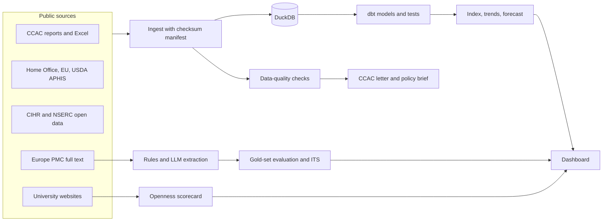

# Open Lab Animals Canada

**Canada has no public, machine-readable data on animals used in science. This project builds it,
audits it, and measures how Canada compares.**

Open data pipeline, analysis and public dashboard covering:

1. **National statistics.** Every CCAC Animal Data Report from 2011 to 2025, converted into a tested,
   tidy dataset with a species crosswalk.
2. **Data-quality audit.** 15 automated checks on the official data, with a formal error log
   prepared for the CCAC.
3. **International comparison and Transparency Index.** Canada against Great Britain, the EU and the US
   on 12 reporting dimensions, with weight-sensitivity analysis.
4. **University Openness Scorecard.** A crawler and rubric that score 26 Canadian universities on what they
   publicly disclose, with quoted evidence for every point (results published after institutional review).
5. **Reporting-quality audit.** 326 open-access Canadian primate research papers checked against ARRIVE 2.0
   and primate-welfare items, plus an interrupted time series around ARRIVE 2.0.
6. **Federal funding.** CIHR and NSERC awards classified by research approach (primate vs non-animal methods).
7. **`arrive-check`.** A free command-line and web checklist tool for authors, reviewers and animal care committees.



## Key findings (v0.1.0, November 2026)

| | |
|---|---|
| Nonhuman primates reported in Canada, 2025 | **8,889** (+103% since 2012; 2023 peak 12,138) |
| Share of primate uses for regulatory testing / fundamental research (2025) | **51% / 19%** |
| Primates per million people, 2025 | **Canada 214**, US 179, Great Britain 27, EU 10 (2023) |
| Transparency Index (0-100) | **Canada 41**, US 53, GB 87, EU 88; Canada last in 74% of 10,000 weightings |
| CCAC data-quality issues | 0 arithmetic errors; **167 labelling/structure warnings**, 67 items for review |
| University Openness Scorecard | results withheld until each university has reviewed its entry |
| Papers reporting housing / fluid regime / surgeries per animal | **17% / 15% / 2%** (rules baseline) |
| Change in reporting after ARRIVE 2.0 | **none detected** for any of 21 items (Holm-corrected) |



Counting units differ between countries; see [docs/methods.md](docs/methods.md) and the conservative
"lab genera, CI C-E" series in the chart.

## Outputs

| Output | Where |
|---|---|
| Dashboard | `make app` (deploy: Streamlit Community Cloud, entry point `app/streamlit_app.py`) |
| Open dataset | `data/processed/*.csv`, documented in [docs/datasheet.md](docs/datasheet.md); Zenodo metadata in `.zenodo.json` |
| Data-quality report | [docs/data_quality_report.md](docs/data_quality_report.md) and the letter in [policy/ccac_data_quality_letter.md](policy/ccac_data_quality_letter.md) |
| Policy brief | [policy/policy_brief.md](policy/policy_brief.md) and [consultation template](policy/consultation_submission.md) |
| University right-of-reply email | [policy/university_right_of_reply.md](policy/university_right_of_reply.md) |
| Preprint draft | [paper/preprint.qmd](paper/preprint.qmd) (numbers computed from the data at render time) |
| `arrive-check` CLI | `arrive-check methods.txt` or `arrive-check --pmcid PMC1234567` |

## Run it

```bash
make setup          # Python 3.12 venv via uv
make download       # fetch public sources, write SHA-256 manifest
make ingest dq      # CCAC, UK/EU/US, CIHR/NSERC; data-quality audit
make analysis       # Transparency Index, trends, forecast
make scorecard      # polite crawl (robots.txt, 1 req/s) + scoring
make corpus audit   # Europe PMC corpus, rules extraction, interrupted time series
python -m olac.db && make dbt   # DuckDB warehouse + 30 dbt tests
make test           # pytest
make app            # dashboard on localhost:8501
```

LLM extraction (optional): `OPENAI_API_KEY=... python -m olac.audit.extract --backend llm --model gpt-4o-mini`.
Any OpenAI-compatible endpoint works (`OPENAI_BASE_URL`).

## Architecture



## Status and what still needs a human

- **Gold-standard labels.** `data/gold/labels_A.csv` and `labels_B.csv` (80 papers x 21 items) must be
  filled in by two annotators following [docs/annotation_guidelines.md](docs/annotation_guidelines.md).
  `python -m olac.audit.evaluate` then reports kappa, per-item F1 and calibration. Until then,
  audit rates are provisional.
- **Scorecard review.** Scorecard results are not in this repository yet. Run `make scorecard` to
  generate them locally, confirm every automated cell in `data/scorecard/review.csv`, and send each
  university the right-of-reply email before publishing. Sites that block automated access, or where no
  animal-research page is found, are reported as "not assessed" rather than scored zero.
- **Rubric cells marked `to_verify`** in `config/transparency_rubric.yaml` (5 of 48) need a primary-source check.
- **Funding precision.** Label `data/interim/funding_precision_sample.csv` to report keyword precision.

## Ethics

Public, aggregate data only. No facility locations, no personal data about researchers or staff, no
leaked documents. Researcher names are never stored. The audit scores papers, not people. The crawler
respects robots.txt and bot protection. See [docs/methods.md](docs/methods.md#9-ethics).

## Licence

Code MIT; data CC BY 4.0. Cite via [CITATION.cff](CITATION.cff).
