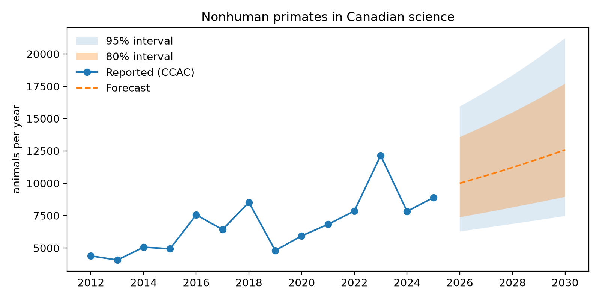
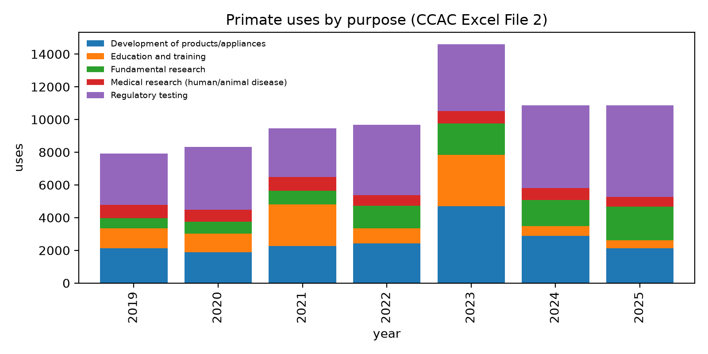
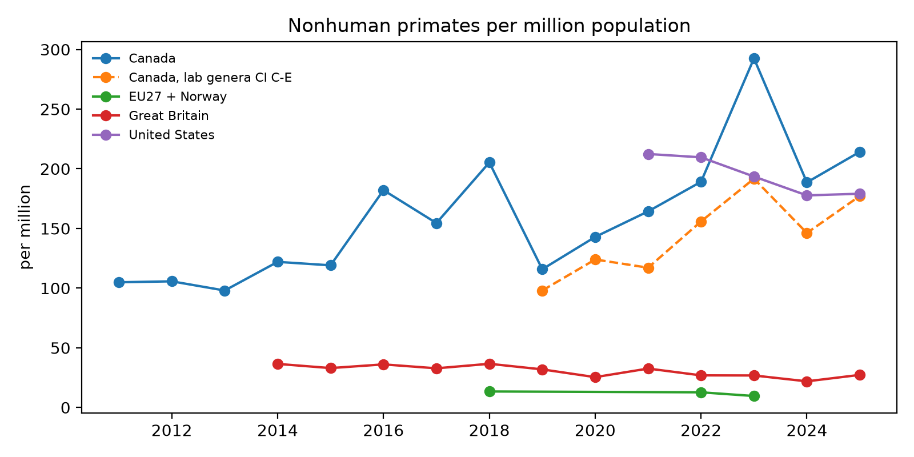
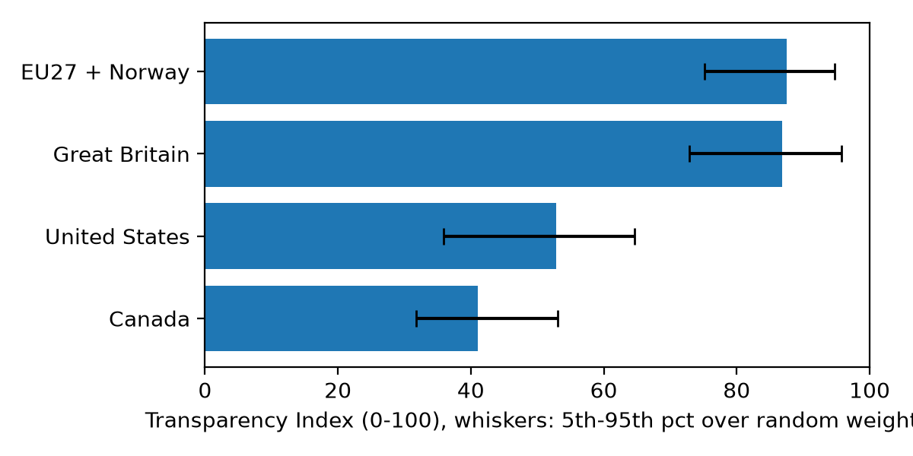
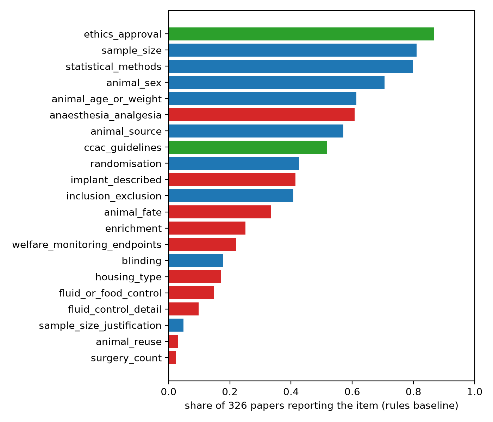

```{python}
import sys, pathlib
sys.path.insert(0, str(pathlib.Path("..").resolve() / "src"))
import pandas as pd
from olac.reports import facts
F = facts()
P = pathlib.Path("../data/processed")
idx = pd.read_csv(P / "transparency_index.csv").set_index("jurisdiction")
ev = pd.read_csv(P / "eval_summary.csv") if (P / "eval_summary.csv").exists() else None
its = pd.read_csv(P / "its_results.csv") if (P / "its_results.csv").exists() else None
```

# Abstract

**Background.** Canada has no statutory public reporting of animals used in science. The only national
statistics are published by the Canadian Council on Animal Care (CCAC), a voluntary certification body.
**Methods.** We converted all CCAC Animal Data Reports from 2011 to 2025 into an open, tested dataset;
audited it for internal consistency; compared nonhuman primate (NHP) use and reporting practice with Great
Britain, the European Union and the United States using a 12-dimension Transparency Index; and audited the
reporting quality of `{python} F.get("audit_n", "N")` open-access Canadian primate neuroscience papers against
ARRIVE 2.0 and primate-welfare items using a rules baseline and a validated LLM extractor.
**Results.** Canada reported `{python} f"{F['nhp_2025']:,}"` NHPs in 2025 (`{python} f"{F['nhp_growth']:+.0%}"` since 2012),
about `{python} f"{F['pc_ca']:.0f}"` per million population against `{python} f"{F['pc_uk']:.0f}"` in Great Britain.
`{python} f"{F['regulatory_share_2025']:.0%}"` of primate uses were for regulatory testing. Canada scored
`{python} f"{F['idx']['canada']:.0f}"`/100 on the Transparency Index, last of four jurisdictions in
`{python} f"{F['idx_last_prob']:.0%}"` of 10,000 random weightings. The CCAC data reconcile arithmetically but contain
`{python} F['dq_counts'].get('warning', 0)` labelling and structural issues.
**Conclusions.** Low-cost reforms used elsewhere (institution-level statistics, actual-severity reporting,
primate origin data, an openness agreement) would close most of the gap.

# Introduction

In April 2026 an undercover investigation reported conditions for nine rhesus macaques used in
neuroscience research at a Canadian university [@lca2026]. The public response exposed how little
systematic information is available about animal use in Canada: CCAC certification and reporting are
voluntary, data are published as national totals, and the CCAC's assessment of complaints is not public.
This paper asks three questions. (1) What do Canada's national statistics show about primate use, and are
they fit for analysis? (2) How does Canada's reporting compare with peer jurisdictions? (3) Do published
Canadian primate studies report the welfare-relevant conditions that public debate turns on?

# Methods

Full methods, code and data are in the project repository and summarised in `docs/methods.md`.

## Data

CCAC summary reports 2011-2025 and sortable Excel files 2019-2025; Home Office statistics for Great Britain
2014-2025 [@homeoffice2026]; European Commission statistical reports [@ec2025]; USDA APHIS annual summaries
FY2021-2025 [@aphis2026]; CIHR and NSERC open award data; Europe PMC open-access full text.

## Analyses

Data-quality checks (15 rules); Transparency Index with Dirichlet weight sensitivity; structural-break and
local-linear-trend models of NHP counts; a conservative per-capita comparison restricted to laboratory
genera in CCAC invasiveness categories C-E; keyword classification of federal awards; and an ARRIVE 2.0
reporting audit [@percie2020] with evidence-quote verification, human gold-standard validation, and an
interrupted time series around the July 2020 release of ARRIVE 2.0.

# Results

## National statistics





## International comparison





```{python}
#| label: tbl-index
#| tbl-cap: "Transparency Index and rank probabilities."
idx[["index_0_100", "score_p05", "score_p95", "p_rank_1", "p_rank_4"]].round(2)
```

## Reporting quality of primate neuroscience papers



```{python}
#| label: tbl-eval
#| tbl-cap: "Extractor accuracy against the human gold standard."
ev.round(3) if ev is not None else pd.DataFrame({"status": ["gold-standard labelling in progress"]})
```

```{python}
#| label: tbl-its
#| tbl-cap: "Interrupted time series: change in reporting after ARRIVE 2.0."
its[["field", "rate_pre", "rate_post", "or_level_change", "p_level_holm"]].round(3) if its is not None else None
```

# Discussion

**Canada's problem is mainly access and granularity, not arithmetic.** The CCAC's published numbers reconcile
across tables and files in every year we examined. What limits their use is structure: national totals only,
prospective rather than actual severity, no primate origin data, species labels that change between years,
and a historical archive that the publisher no longer hosts. Each of these has a working precedent in at least
one comparison jurisdiction, which is why Canada's Transparency Index ranking is robust to the choice of weights.

**Primate use is dominated by regulatory testing.** About half of primate uses in 2025 were for regulatory
testing, mostly cynomolgus macaques. Public attention after the 2026 investigation focused on university
neuroscience, which accounts for a minority of use. Policy aimed only at universities would leave most primate
use untouched; regulatory acceptance of non-animal methods is the larger lever.

**Published papers do not let readers judge welfare.** Fewer than one in five papers stated housing conditions,
about one in seven stated whether fluid was controlled, and almost none stated how many surgeries each animal
underwent. These are exactly the conditions at issue in public debate about primate neuroscience. We detected
no change after ARRIVE 2.0, consistent with earlier evidence that endorsing reporting guidelines without
enforcement has little effect.

**Limitations.** CCAC data cover certified institutions only. Counting units differ across jurisdictions; we
report a conservative sensitivity series but cannot fully harmonise them. The NHP series is short (14 comparable
years), so the forecast is a scenario. The corpus is limited to open-access papers indexed by Europe PMC.
Extraction results are from a rules baseline pending validation against the two-annotator gold standard. Award
classification uses keywords. The university scorecard is an automated first pass awaiting institutional
review, and five institutions could not be assessed automatically.

# Data and code availability

Dataset: Zenodo DOI [to be minted]. Code: [repository URL], MIT licence. Dashboard: [URL].

# References
